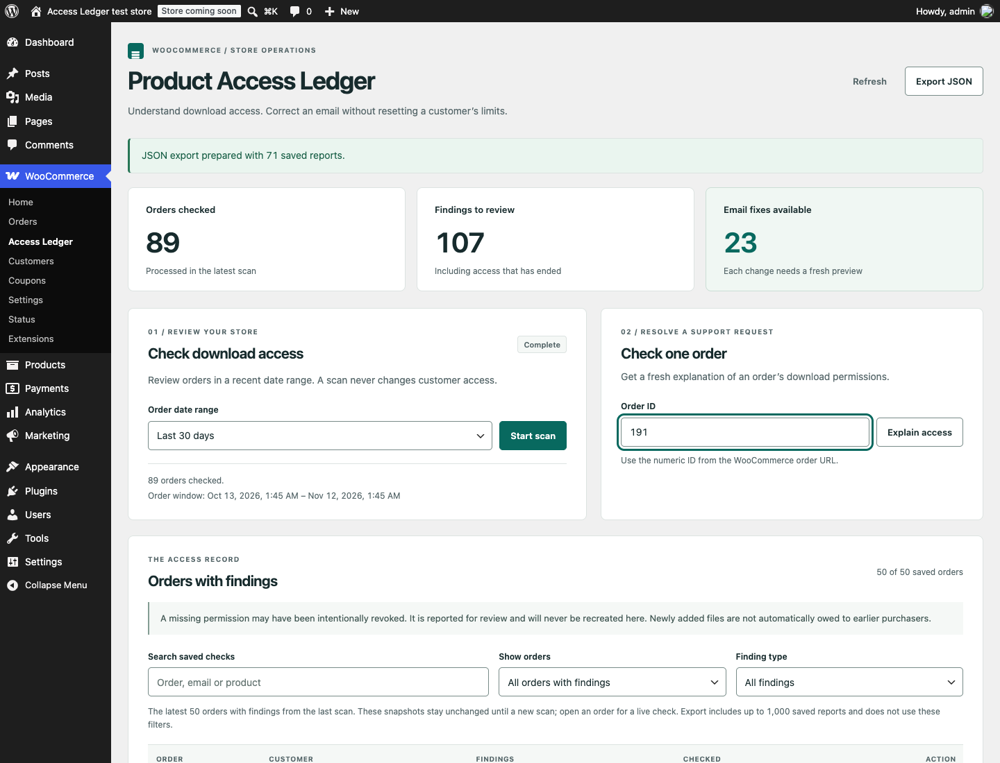
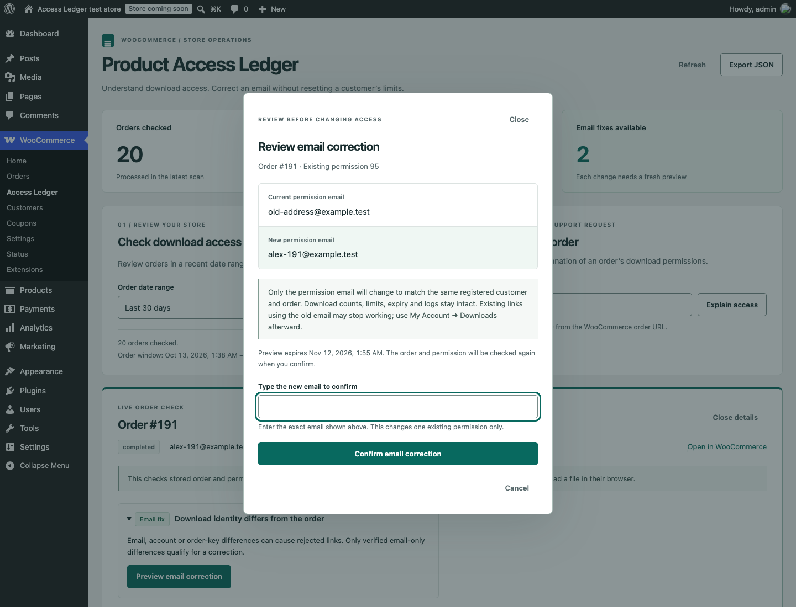

# Access Ledger — WooCommerce download troubleshooting

[Screenshots and step-by-step setup tutorial](https://memberfix.studio/plugins/access-ledger/)

**Find out why a customer cannot download a purchase—before resetting anything.**

A free, open-source WooCommerce plugin for troubleshooting digital-download access. Inspect one order or scan recent orders, read the evidence behind each finding, and preview a narrowly verified email correction that keeps download allowances and history intact.

Version **1.1.0** adds older-findings pagination and CSV export. See the [changelog](CHANGELOG.md) and [API contract](docs/CONTRACT.md).

## The problem

A customer paid but their download link fails. Regenerating permissions is tempting, but WooCommerce documents that it deletes existing permissions and logs and loses download counts. Sometimes the restriction is correct: a download expired, its allowance was used, a purchase was refunded, or a file was added after the original purchase.

Access Ledger separates **observed mismatches**, **expected restrictions** and **uncertain cases**. It does not assume that missing access should be restored.

## What you can do

- **Investigate an order:** see order eligibility, current file permissions, remaining downloads, expiry, identity differences and duplicate records.
- **Scan recent purchases:** resumable, bounded batches with progress and cancellation; choose up to 365 days. Stored observations carry timestamps.
- **Triage findings:** start with the latest 50 saved orders, then **Load older findings** in pages of up to 50 from the same scan. Search and filters cover loaded findings only. Refresh resets to the latest page; a new scan discards the previous scan's loaded results.
- **Export evidence:** download JSON or CSV on demand, using the same newest 1,000 reports at most from the latest scan. Loaded pages and UI filters do not change the export. CSV has one row per report, with full findings and permissions in JSON cells; formula-like cells receive a leading apostrophe.
- **Preview an email correction:** compare before and after. Corrections are offered only when the permission and order already belong to the same registered account, the order key matches, and the account email matches the order billing email.
- **Keep an audit trail and undo:** corrections record the operator and timestamp; undo refuses to overwrite changed order/permission identity.

No hosted service, subscription, tracking, customer messages or remote API calls.

## Install

1. Download **access-ledger.zip** from [Releases](https://github.com/memberfixstudio-ind/access-ledger/releases).
2. In WordPress, select **Plugins → Add New → Upload Plugin** and activate it.
3. Open **WooCommerce → Access Ledger**. Start with an order ID or a recent-order scan.

Requires WordPress 6.8+, PHP 8.2+, WooCommerce 10+ and InnoDB tables for corrections. Both legacy and High-Performance Order Storage use WooCommerce's order APIs. Supported and actually tested combinations are recorded in [validation](docs/VALIDATION.md).

## What a correction changes

Exactly one field: `user_email` on one **existing** WooCommerce download permission. It never changes the permission ID, account ID, order key, download ID, count, remaining allowance, expiry, file URL or download log.

Corrections are blocked for guests, account transfers, differing account/billing emails, order-key mismatches, expired or exhausted permissions, any refund, duplicate grants and removed files. A preview expires after ten minutes and is tied to its operator and observed order identity. Current evidence is rechecked before applying a conditional write.

An email correction can invalidate links containing the old email. The customer should open **My Account → Downloads** for the current link. Access Ledger does not send an email for you.

## Boundaries that matter

- A missing permission might have been deliberately revoked. **No permission is created or revived.**
- Current product files are not proof of purchase-time entitlement. Files added after purchase are marked uncertain.
- Stored reports are observations, not a complete event history. Reopen an order for live evidence.
- This diagnoses database permissions. It does not prove that a file exists, a CDN accepts the request, or an email reached the customer.
- Third-party access filters can add restrictions. No universal “customer can download” guarantee is made.
- Scans follow order creation dates. Use order lookup for older purchases updated recently. WP-Cron requires traffic or a system cron; the dashboard also advances scans while open.
- This release supports WooCommerce digital downloads. MemberPress, LearnDash, subscriptions and CRM synchronization are not integrations in this release.

## Common questions

### Why can't a customer download a paid WooCommerce order?

Payment alone does not explain download access. Look up the order in **WooCommerce → Access Ledger** to inspect its permissions, expiry, remaining allowance and customer identity. The report separates observed mismatches from expected restrictions and uncertain cases; it gives the support team evidence before they change anything.

### Can I fix an email mismatch without resetting download limits?

For eligible orders, Access Ledger previews a correction to the email on one existing permission. It rechecks the account, billing email, order key and permission before applying the change. Download counts, remaining allowance, expiry and history stay intact. Cases outside these checks require manual review; see [what a correction changes](#what-a-correction-changes).

### Will it restore missing or revoked download permissions?

No. Missing access may be intentional. Access Ledger reports the finding but never creates or revives permissions. It also does not repair missing files, CDN failures or undelivered emails.

### Does it work with WooCommerce HPOS?

Yes. It uses WooCommerce's order APIs and is tested with both High-Performance Order Storage and legacy order storage. The [validation record](docs/VALIDATION.md) lists the tested versions and limits.

## Privacy and security

Only users with `manage_woocommerce` can use the UI or API. WordPress cookie authentication requires a REST nonce, including for pagination and exports. No unauthenticated webhook or public endpoint is installed. Reports contain customer emails; treat exports as customer records. Order keys, usable download links and file URLs are excluded from reports and exports.

Reports expire after 30 days and correction history after 90 days, with cleanup during scan operations and daily WP-Cron. Data remains local. Uninstall preserves evidence by default; to delete plugin-owned data on uninstall, set `define('ACCESS_LEDGER_DELETE_DATA', true);` in `wp-config.php` first. WooCommerce data is never deleted. See [security](SECURITY.md).

## Engineering and verification

- PHP with WooCommerce order APIs, a small plugin-owned report/audit store, and scoped native JavaScript/CSS. No build step or production dependency.
- Conditional updates preserve counters consumed between preview and correction. Transactions keep the correction and audit record together.
- Tests use real WordPress and WooCommerce objects, permission rows and download logs—not mocks of the integration.
- The test suite covers access explanations, identity boundaries, replay/staleness, refunds/revocation, concurrent consumption, undo and API authorization.

Run only on a disposable database: define `ACCESS_LEDGER_TESTS=true`, activate WooCommerce and Access Ledger, then run `wp eval-file tests/integration.php`. See the [CI workflow](.github/workflows/test.yml).

[Research and agent vote](docs/RESEARCH.md) · [Validation record](docs/VALIDATION.md) · [Changelog](CHANGELOG.md)

Built by [Rohan Salave](https://www.linkedin.com/in/rohan-salave-362475189/) at [MemberFix Studio](https://memberfix.studio/) · GPL-2.0-or-later.
